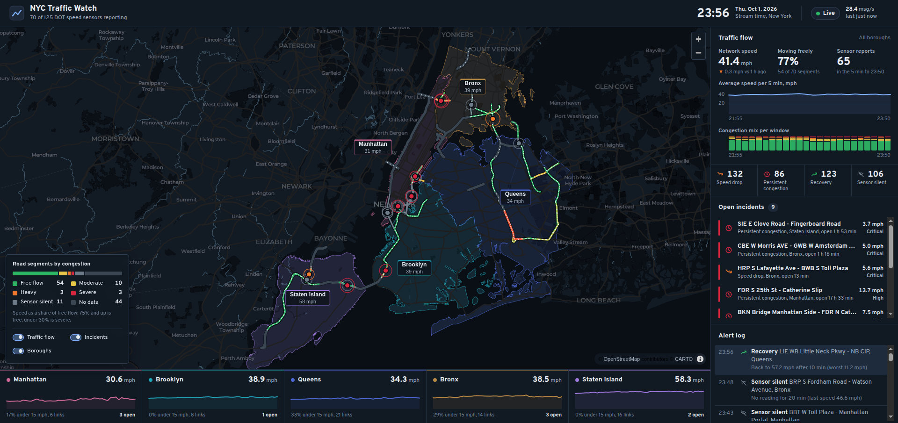

# NYC traffic incident detection with Kafka and Apache Flink

Homework 1 for *Introduction to Mining Massive Data* (FINKI): stream processing with Apache Flink.

One day of NYC DOT real-time traffic speeds (125 road segments, a reading every ~5 minutes) is replayed into
Kafka by a Python producer in simulated real time, with some readings deliberately out of order.
A Flink 2.3 job (Java 17) processes it in event time:

- **analytics module**: per road segment a sliding 15 min / 5 min window (average, min, max, stddev speed,
  free-flow speed, congestion level) and per borough a tumbling 5 min window;
- **event-driven module**: a per-segment state machine with keyed state and event-time timers that raises
  `SPEED_DROP`, `PERSISTENT_CONGESTION`, `RECOVERY` and `SENSOR_SILENT` alerts.

All results are JSON messages in Kafka topics. A live dashboard (React + a Python Socket.IO bridge) shows them on
a map while the stream is flowing. Everything starts with one `docker compose up`.



Documentation (dataset, architecture, both modules, watermarks, earliest/latest comparison):
[`docs/DOCUMENTATION.pdf`](docs/DOCUMENTATION.pdf) (source: [`docs/DOCUMENTATION.md`](docs/DOCUMENTATION.md)).
Message formats of every topic: [`docs/CONTRACT.md`](docs/CONTRACT.md).

## Repository layout

| Path | What |
|---|---|
| `producer/` | Python: `download_data.py` (data + road geometry), `replay.py` (cleaning, event time, disorder), `producer.py` (Kafka replay), tests. [README](producer/README.md) |
| `flink-job/` | Maven project, Flink 2.3 / Java 17: the job, both modules, tests, Docker image that submits the job. [README](flink-job/README.md) |
| `dashboard/` | `server/`: Python bridge Kafka → Socket.IO, `web/`: React + MapLibre app. [README](dashboard/README.md) |
| `docker-compose.yml`, `.env.example` | the whole stack with one command, and its settings |
| `scripts/consume.sh` | print a topic / count the messages of every topic in the compose Kafka |
| `scripts/offset-experiment.sh` | the earliest vs latest experiment (+ `offset_experiment_report.py`) |
| `scripts/build-pdf.sh` | `docs/DOCUMENTATION.md` → `docs/DOCUMENTATION.pdf` |
| `docs/` | documentation, message contract, architecture diagram |

The data is not in the repository; it is downloaded into `data/` (see below).

## Prerequisites

- Docker with Docker Compose v2 (for the one-command start, nothing else is needed)
- For running the modules by hand: Java 17 (`flink-job/.mise.toml` pins Temurin 17 for [mise](https://mise.jdx.dev);
  Maven comes with the wrapper `./mvnw`), [uv](https://docs.astral.sh/uv/) (Python 3.12 venvs; the Kafka client
  libraries have no wheels for newer Pythons yet), Node.js 20.19+ / 22.12+ for the dashboard UI.

## Quick start: everything with one command

```sh
docker compose up -d --build
```

- Dashboard: <http://localhost:8000> · Flink Web UI: <http://localhost:8081> · Kafka from the host: `localhost:9092`
- The first start downloads the data into `data/` (`traffic.csv`, `links.geojson`, about 5 minutes) if it is not
  there yet. Then the producer replays 2026-10-01 at 60× speed (one hour of data per minute, the whole day in
  ~24 minutes) and exits.
- Start order: `kafka` → `kafka-init` (creates the 5 topics with 4 partitions each) → `jobmanager` + `taskmanager`
  → `flink-job` (submits the job with `--offset latest` and waits until it is RUNNING) → `producer`;
  `dashboard` starts after `kafka-init`.

> **Ports 9092 and 8081 are also used by the course stack** (containers `kafka`, `jobmanager`, `taskmanager`).
> Stop it first (`docker stop taskmanager jobmanager kafka`, later `docker start kafka jobmanager taskmanager`)
> or move this stack to other ports: `KAFKA_PORT=19092 FLINK_UI_PORT=18081 docker compose up -d --build`.

Useful settings (environment variables or a `.env` file, all listed in [`.env.example`](.env.example)):

```sh
START_AT=06:00 SPEEDUP=120 docker compose up -d --build   # start at the morning rush hour: alerts within ~2 min
LOOP=true docker compose up -d --build                    # replay forever (each round one day later)
FLINK_OFFSET=earliest docker compose up -d --build        # the job reads the input topic from the beginning
FLINK_MAX_OOO_S=30 docker compose up -d --build           # watermark bound 30 s < producer delay 120 s:
                                                          #   late readings appear in traffic-late-readings
```

Watching and stopping:

```sh
docker compose ps                                  # flink-job and kafka-init exit after doing their job (exit 0)
docker compose logs -f producer                    # replay progress
scripts/consume.sh traffic-incidents               # print a topic from the beginning (Ctrl+C to stop)
scripts/consume.sh traffic-link-stats --max-messages 5
scripts/consume.sh --counts                        # number of messages in every topic
docker compose down                                # stop and remove the containers (topics are not kept)
docker compose down -v                             # ... and also the volumes: a completely fresh start next time
```

Changing a setting of an already started stack: `docker compose down` first, because the job is only submitted
once and `kafka-init`/`flink-job`/`producer` are one-shot containers.

## Manual mode: the modules against the course Kafka (and Flink)

Kafka from the course repository (Kafka on `localhost:9092`, inside Docker `kafka:9093`):

```sh
git clone https://github.com/stefanandonov/RNMP_homework1.git && cd RNMP_homework1
docker compose up -d --wait
```

All following commands run from the root of **this** repository.

### 1. Download the data

```sh
python3 producer/download_data.py          # 2026-10-01 -> data/traffic.csv + data/links.geojson (standard library only)
python3 producer/download_data.py --start 2026-10-02 --end 2026-10-04   # another period
```

The readings alone can also be downloaded with the command from the assignment (the producer reads this file
the same way; only the dashboard map needs `data/links.geojson` from `download_data.py`):

```sh
mkdir -p data
curl -G -o data/traffic.csv https://data.cityofnewyork.us/resource/i4gi-tjb9.csv \
  --data-urlencode '$select=link_id,link_name,borough,speed,travel_time,status,data_as_of' \
  --data-urlencode "\$where=data_as_of between '2026-10-01T00:00:00' and '2026-10-02T00:00:00'" \
  --data-urlencode '$limit=500000'
```

### 2. Create the topics (4 partitions each)

The course Kafka creates missing topics automatically, but with only 1 partition:

```sh
for t in traffic-readings traffic-link-stats traffic-borough-stats traffic-incidents traffic-late-readings; do
  docker exec kafka /opt/kafka/bin/kafka-topics.sh --bootstrap-server localhost:9092 \
    --create --if-not-exists --topic "$t" --partitions 4 --replication-factor 1
done
```

### 3. Start the Flink job

Build once (Java 17 on the `PATH`, e.g. `cd flink-job && mise install`):

```sh
cd flink-job && ./mvnw clean package -DskipTests && cd ..   # -> flink-job/target/traffic-flink-job-1.0.jar
```

**a) Locally** (embedded mini-cluster, reads `localhost:9092`):

```sh
cd flink-job
./mvnw -q compile exec:exec -Dexec.args="--offset latest"     # only what the producer writes from now on
./mvnw -q compile exec:exec -Dexec.args="--offset earliest"   # the whole topic from the beginning
```

**b) On the course Flink cluster** (containers `jobmanager`/`taskmanager` on the same Docker network as `kafka`,
started as in the course's `flink-demo/CLUSTER.md`; Web UI http://localhost:8081):

```sh
docker cp flink-job/target/traffic-flink-job-1.0.jar jobmanager:/tmp/traffic-job.jar
docker exec jobmanager flink run -d /tmp/traffic-job.jar --bootstrap kafka:9093 --offset latest
docker exec jobmanager flink list                 # stop: docker exec jobmanager flink cancel <JobID>
```

`--offset earliest|latest` chooses where the Kafka source starts. Other flags (`--max-ooo-s`, `--parallelism`,
thresholds of the detector, topic names) are listed in [`flink-job/README.md`](flink-job/README.md).
Do not submit from the Flink Web UI: in Flink 2.3 its *Program Arguments* field does not reach the job.

### 4. Start the producer

```sh
cd producer && uv venv --python 3.12 .venv \
  && uv pip install --python .venv/bin/python -r requirements.txt -r requirements-dev.txt && cd ..   # once

producer/.venv/bin/python producer/producer.py --input data/traffic.csv                  # 60x: 1 h of data per minute
producer/.venv/bin/python producer/producer.py --input data/traffic.csv --speedup 120 --start-at 06:00
producer/.venv/bin/python producer/producer.py --input data/traffic.csv --speedup 0     # as fast as possible
```

`producer/run.sh [flags]` does the same with automatic venv setup and download. Flags: `--speedup`,
`--disorder-ratio` (default 0.1), `--max-delay-s` (default 120), `--seed`, `--start-at`, `--limit`, `--loop`,
`--bootstrap` (see [`producer/README.md`](producer/README.md)).

### 5. Look at the results

```sh
./run.sh consume_messages.py traffic-incidents      # run inside the RNMP_homework1 folder
docker exec kafka /opt/kafka/bin/kafka-console-consumer.sh --bootstrap-server localhost:9092 \
  --topic traffic-link-stats --from-beginning
```

### 6. Dashboard

```sh
cd dashboard/server && uv sync && cd ../web && npm install && cd ../..   # once

# production: one process on http://localhost:8000
(cd dashboard/web && npm run build)
(cd dashboard/server && uv run python -m bridge --offset earliest)

# development with hot reload: bridge + Vite on http://localhost:5173
(cd dashboard/server && uv run python -m bridge --offset earliest)   # terminal 1
(cd dashboard/web && npm run dev)                                    # terminal 2
```

## Earliest vs latest experiment

```sh
docker stop taskmanager jobmanager kafka      # the experiment uses ports 9092 and 8081
scripts/offset-experiment.sh                  # ~10 min: both runs on fresh stacks + comparison
docker start kafka jobmanager taskmanager
```

1. **latest**: the job is started first, then the producer replays the day at `SPEEDUP=600` (the day in ~2.4 min).
2. **earliest**: the producer first writes the whole day as fast as possible with no job running, then the job is
   started and reads the topic from the beginning.

The raw dumps go to `experiment-out/` (not in git), the comparison to `experiment-out/report.md`.
Measured on the full day (21,073 readings): both runs produced the same 21,578 link statistics, 1,435 borough
statistics and 448 alerts (only a few borough averages differ by 0.01 mph from floating-point summation order);
the latest run took 144 s (as long as the replay), the earliest run 4 s after job start.
Explanation and what happens to the last windows and timers: section 7 of the
[documentation](docs/DOCUMENTATION.pdf).

## Tests

```sh
producer/.venv/bin/python -m pytest -q producer/tests    # producer: cleaning, event time, out-of-order schedule
cd flink-job && ./mvnw test && cd ..                     # Flink: window math, detector (operator test harness), JSON
cd dashboard/server && uv run pytest && cd ../..         # bridge state
cd dashboard/web && npm run build && cd ../..            # UI type check + production build
```

## Documentation

`docs/DOCUMENTATION.pdf` is built from `docs/DOCUMENTATION.md` with `scripts/build-pdf.sh`
(python-markdown via `uvx` + headless Google Chrome).
