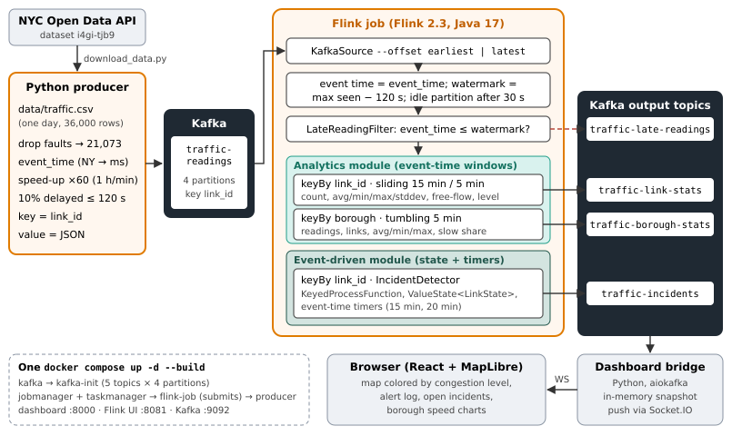
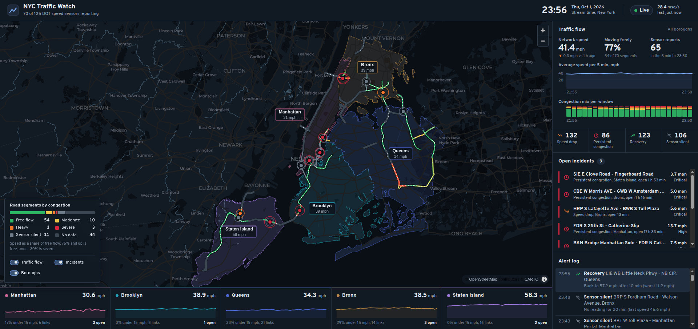

# NYC traffic incident detection with Kafka and Apache Flink

<p class="subtitle">Homework 1, Introduction to Mining Massive Data (FINKI) · Kafka 3.9, Flink 2.3 (Java 17),
Python producer, React + Python dashboard · how to run it: <code>README.md</code></p>

## 1. Dataset and key

**NYC DOT Real-Time Traffic Speed Data** (NYC Open Data, dataset `i4gi-tjb9`):
<https://data.cityofnewyork.us/Transportation/DOT-Traffic-Speeds-NBE/i4gi-tjb9>.
Sensors on 125 road segments ("links") of New York's highways and major roads report the average speed and
travel time of the segment, each roughly every 5 minutes. Fields used: `link_id`, `link_name`, `borough`,
`speed` (mph), `travel_time` (s), `status`, `data_as_of` (event time, New York local time) and, for the map,
`encoded_poly_line` (the segment's shape). We replay one day, **2026-10-01**.

| Fact (2026-10-01) | Value |
|---|---|
| rows | 36,000 (125 links, 2,675 distinct timestamps, ~25 rows per minute) |
| sensor faults (`status = -101`, speed 0), dropped by the producer | 14,927 |
| valid readings sent to Kafka | **21,073** from 81 links (44 links are faulty all day) |
| gap between two readings of a link | normally 5 min, sometimes 10–35 min, at most 335 min |
| speed | 2.5–84.5 mph, median 39.8 mph |

**Key: `link_id`.** Every segment is an independent sensor and every computation (window statistics, baseline,
incident state machine) is per segment, so `link_id` is the natural partition key: all readings of one segment go
to the same Kafka partition (Kafka keeps their order) and to the same Flink subtask (its keyed state lives there),
while the 81 active segments spread evenly over 4 partitions and parallel subtasks. The borough statistics are
keyed by `borough` (5 keys) inside Flink.

**Cleaning** (`producer/download_data.py`, `producer/replay.py`): faulty readings and duplicate
`(link_id, data_as_of)` pairs are dropped; `data_as_of` has no offset, so it is interpreted in
`America/New_York` and converted to epoch milliseconds (`event_time`). For the map, `link_points` is unusable
(cut at 255 characters, corrupted numbers); the geometry is decoded from `encoded_poly_line` after undoing the
API's broken backslash escaping, then points outside the NYC bounding box and isolated spikes are removed
(`data/links.geojson`).

## 2. Architecture



<p class="caption">Figure 1. Data flow. Every arrow between modules is a Kafka topic with JSON messages
(formats in <code>docs/CONTRACT.md</code>).</p>

| Topic | Written by | Key | Content |
|---|---|---|---|
| `traffic-readings` | producer | `link_id` | raw readings (input) |
| `traffic-link-stats` | analytics module | `link_id` | sliding-window statistics per link |
| `traffic-borough-stats` | analytics module | `borough` | tumbling-window statistics per borough |
| `traffic-incidents` | event-driven module | `link_id` | incident alerts |
| `traffic-late-readings` | Flink side output | `link_id` | readings that arrived behind the watermark |

All topics have 4 partitions. The whole system runs with `docker compose up -d --build` (Kafka in KRaft mode,
a Flink session cluster with one JobManager and one TaskManager with 4 slots, a one-shot container that submits
the job, the producer and the dashboard). Flink checkpoints every 10 s; the Kafka sinks are at-least-once.

## 3. Producer (`producer/`)

1. **Replay in event-time order.** The cleaned readings are sorted by `event_time` and sent as JSON with
   `link_id` as the Kafka key.
2. **Simulated real time with a speed-up.** A record due at event time *t* is sent at wall-clock
   `start + (t − t_first) / speedup`, measured from the start (no drift; readings with the same timestamp go out
   together). Default `--speedup 60`: one hour of data per minute, the day in about 24 minutes.
   `--speedup 0` sends as fast as possible.
3. **Out of order with a bounded delay.** A random 10% of the readings (`--disorder-ratio 0.1`) get a
   *release time* `event_time + d`, `d` uniform in (0, 120 s] (`--max-delay-s 120`); records are sent in order of
   release time, so a delayed reading is sent after readings that happened up to 2 minutes later
   (it is marked `"delayed": true` for debugging; Flink does not use it). `--seed 42` makes the schedule
   reproducible, which the earliest/latest experiment relies on.

Consequence: **no record is ever more than 120 s of event time behind the newest record sent before it.**
This is the number the watermark is built on (section 6).

## 4. Analytics module: event-time windows

```java
readings.keyBy(r -> r.linkId)
        .window(SlidingEventTimeWindows.of(Duration.ofMinutes(15), Duration.ofMinutes(5)))
        .aggregate(new LinkStatsAggregator(), new LinkStatsWindowFunction());
readings.keyBy(r -> r.borough)
        .window(TumblingEventTimeWindows.of(Duration.ofMinutes(5)))
        .aggregate(new BoroughStatsAggregator(), new BoroughStatsWindowFunction());
```

**Per link, sliding window 15 min, slide 5 min → `traffic-link-stats`.** A link reports every ~5 minutes, so a
15-minute window holds about 3 readings: enough to smooth single noisy readings and to compute a meaningful
standard deviation, while a new result still comes out every 5 minutes, i.e. once per reporting cycle.
Output: `count`, average/min/max/stddev speed, average travel time, `free_flow_mph`, `congestion_ratio`, `level`.

**Per borough, tumbling window 5 min → `traffic-borough-stats`.** One snapshot of the borough per reporting
cycle; tumbling windows count every reading exactly once, so sums and shares are meaningful. Output: number of
readings and distinct links, average/min/max speed, `slow_share` (share of readings below 15 mph).

**How it is computed.** The `AggregateFunction` keeps a small accumulator per window (count, sum, sum of squares,
min, max) and updates it on every reading, so window contents are never buffered. When the window fires, the
`ProcessWindowFunction` receives the single accumulator and adds the window bounds and the congestion level.

**Free-flow speed and congestion level.** What is "slow" depends on the road (8 mph is normal on a bridge
approach, not on an expressway), so each link learns its own free-flow speed, kept in `context.globalState()`
(keyed state of the link shared by all its windows; `windowState()` would be dropped with the window):
`free_flow = max(window avg, 0.998 × previous free_flow)`: it jumps up to any faster average immediately and
otherwise slowly decays (about half per day), so one unusual window does not dominate forever.
`congestion_ratio = avg / free_flow` (clamped to [0, 1]) gives the level: ≥ 0.75 `FREE`, ≥ 0.5 `MODERATE`,
≥ 0.3 `HEAVY`, otherwise `SEVERE`.

## 5. Event-driven module: incident detection with state and timers

`IncidentDetector` is a `KeyedProcessFunction<String, TrafficReading, IncidentAlert>` keyed by `link_id`.
Its state is one `ValueState<LinkState>` per link: learned baseline speed, number of readings seen, last reading
(time, speed), phase (`NORMAL` / `DROPPED` / `CONGESTED`), incident start and worst speed, the count of good
readings in a row, and the times of its two registered event-time timers (so they can be deleted or recognized).

| From | Event | To | Alert |
|---|---|---|---|
| NORMAL | reading < 50% of baseline (after a 3-reading warm-up) | DROPPED | `SPEED_DROP`; register timer at *drop + 15 min* |
| DROPPED | timer fires and the latest reading is still < 75% of baseline | CONGESTED | `PERSISTENT_CONGESTION` |
| DROPPED / CONGESTED | 2 readings in a row ≥ 75% of baseline | NORMAL | `RECOVERY` (duration, worst speed); delete the 15-min timer |
| any | silence timer at *last reading + 20 min* fires (re-armed on every reading) | same | `SENSOR_SILENT` (once per silence) |

- **Baseline**: exponentially weighted moving average of the link's speed (α = 0.1; plain average during the
  3-reading warm-up), updated **only while NORMAL**, so an incident does not drag it down. After a silence of
  20+ minutes the baseline is learned again (e.g. night → morning rush hour).
- **Hysteresis**: an incident opens below 50% but closes only at 75%, twice in a row, so a link hovering around
  50% does not produce a stream of drop/recovery alerts.
- **Timers are event-time timers**: they fire when the *watermark* passes their time, i.e. "15 minutes of data
  later", independent of the replay speed.
- **Overdue deadlines.** When a topic is read much faster than real time (`--offset earliest`), a link's next
  reading can reach the operator before the watermark has passed its timer (the watermark lags behind). That
  reading proves that the deadline has passed in event time, so `processElement` first does the timer's work
  (persistence check or silence alert) and deletes the timer. The alerts therefore depend only on event
  times, not on how fast Kafka is read.
- **Severity** grows with how slow the link is (ratio < 0.4 / 0.3 / 0.15) and with the duration (15+ and
  60+ minutes). All thresholds are command-line flags.

Example alert from the experiment run (ratio 0.237 gives HIGH, one level up after 15 minutes: CRITICAL;
`event_time` of a timer alert is the deadline itself, drop + 15 min):

```json
{
  "alert_id": "4620298-1790830806000-PERSISTENT_CONGESTION",
  "type": "PERSISTENT_CONGESTION",
  "link_id": "4620298",
  "link_name": "GWB E LOWER LEVEL PLAZA - CBE E LOWER LEVEL AMSTERDAM AVE",
  "borough": "Manhattan",
  "event_time": 1790830806000,
  "incident_start": 1790829906000,
  "duration_s": 900,
  "speed_mph": 17.39,
  "baseline_mph": 73.32,
  "ratio": 0.237,
  "min_speed_mph": 17.39,
  "severity": "CRITICAL",
  "message": "Still congested after 15 min: 17.4 mph (24% of the usual 73.3 mph)"
}
```

## 6. Event time and watermarks

- **Event time** is the reading's `event_time` (when the sensor measured it), assigned with
  `withTimestampAssigner`; processing time is not used anywhere.
- **Watermark**: `WatermarkStrategy.forBoundedOutOfOrderness(Duration.ofSeconds(120))`, i.e. the watermark
  trails the largest event time seen by 120 s. **Why 120 s:** the producer delays a reading by at most 120 s of
  event time (section 3), so with this bound a delayed reading is never behind the watermark; nothing is lost,
  and every window and timer waits at most 2 extra minutes of event time (2 s of wall clock at speed-up 60).
  A smaller bound gives results sooner but loses delayed readings; a larger one only adds latency.
- **Per partition and idleness**: the Kafka source keeps a watermark per partition and emits the minimum.
  `withIdleness(30 s)` excludes a partition that has had no data for 30 s of wall clock, so one empty partition
  cannot stop all windows.
- **Late readings**: `LateReadingFilter` (a `ProcessFunction` right after the source) sends a reading whose
  event time is at or behind the current watermark to a side output → `traffic-late-readings` with
  `late_by_ms`, instead of letting the windows drop it silently. With the default settings this topic stays
  empty. To demonstrate it, run Flink with a bound smaller than the producer's delay
  (`FLINK_MAX_OOO_S=30 docker compose up -d --build`): in our test run 8 readings went to the side output,
  the latest one 31 s behind the watermark.

## 7. Earliest vs latest offset

Requirement 6: the job takes `--offset earliest|latest` (Kafka source `OffsetsInitializer.earliest()` /
`latest()`). Both runs used the same data, the full day of 21,073 readings, on a fresh Docker Compose stack
(Flink parallelism 2, 4 partitions), with the same producer seed, so the input topic held the same records in the
same order (verified). The procedure is scripted in `scripts/offset-experiment.sh`; it dumps every topic and
`scripts/offset_experiment_report.py` compares them.

- **latest**: job started first (`--offset latest`), then the producer replays the day at `SPEEDUP=600`
  (one day in 144 s), i.e. data arrives "live" while the job runs.
- **earliest**: the producer first writes the whole day at full speed (`SPEEDUP=0`, 0.2 s) with no job
  running, then the job is submitted with `--offset earliest` and reads the topic from the beginning.

| | latest | earliest |
|---|---:|---:|
| duration measured from | first input record | job submission |
| first output after that | 1.0 s | 2.7 s (deployment, Kafka connection) |
| **last output after that** | **143.9 s** (= replay time) | **4.0 s** |
| `traffic-link-stats` | 21,578 | 21,578 |
| `traffic-borough-stats` | 1,435 | 1,435 |
| `traffic-incidents` | 448 | 448 |
| of which `SPEED_DROP` / `PERSISTENT_CONGESTION` / `RECOVERY` / `SENSOR_SILENT` | 132 / 86 / 124 / 106 | 132 / 86 / 124 / 106 |
| `traffic-late-readings` | 0 | 0 |
| duplicates | 0 | 0 |
| final watermark (all operators) | 23:56:11.999 | 23:56:11.999 |

Durations are wall-clock times from the Kafka record timestamps (time of writing). A second complete run of the
script gave the same counts, alerts and end-of-data numbers, durations of 144.0 s (latest) and 4.4 s (earliest),
and 8 instead of 16 borough windows with the 0.01 difference explained below.

**Are the results the same?** Yes. All 21,578 link statistics and all 448 alerts are identical (same set of
messages, every field equal). Of the 1,435 borough windows, 16 differ in `avg_speed_mph` by 0.01: a borough window
receives readings of many links from both source subtasks (different partitions), the order in which they
arrive differs between the runs, and floating-point addition is not associative, so the sum can differ in the last bit and the
rounding to 2 decimals flips. The per-link results are not affected because one link's readings always come from
one partition in the same order. The order of messages in the output topics also differs (results of
different keys are interleaved differently), which does not matter for keyed results. Why they agree:

1. **Event time, not arrival time.** Window membership and timer deadlines come from `event_time`, so the
   speed at which records are read (600× vs. as fast as possible) does not change which readings end up together.
2. **Windows fire on the watermark**, which is derived from the data. In both runs every reading was on time
   (0 late): the producer's disorder (≤ 120 s) is within the watermark bound. With a bound smaller than the
   disorder, the number of late readings would depend on how the partitions interleave, which differs between a
   live and a catch-up run, and results would no longer be identical.
3. **The per-link state sees the same sequence**: one link is one Kafka partition, read in order, so the
   baseline, the incident state machine and the free-flow speed evolve identically.
4. **Timers vs. watermark lag.** In the earliest run the topic is read at full speed and the watermark
   (emitted every 200 ms) lags far behind the records, so a link's next reading can arrive before its 15- or
   20-minute timer has fired. The detector handles such overdue deadlines in `processElement` (section 5), so
   the alerts are the same as when the timer fires on time. Without this, the earliest run could produce
   different `PERSISTENT_CONGESTION`/`SENSOR_SILENT` alerts.
5. **No failures**, so the at-least-once sinks wrote no duplicates (after a restart from a checkpoint they could).

**How long did they take?** The latest run lasts as long as the producer: here 144 s of wall clock for one
day of data at 600× (24 min at the default 60×, a whole day in real time); the job keeps up and every result appears
immediately after the reading that moves the watermark past the window end (the last output came 0.1 s before the
producer's last record). The earliest run is limited only by processing speed: the whole day was processed in
about 1.3 s after the first result, 4.0 s including job start.

**What happens when the data ends?** In both runs the job stays `RUNNING`: the Kafka source is unbounded and
simply waits for new records. The watermark stops at *last event time − 120 s* = 23:56:11.999 (last reading
23:58:12), because there is no newer event time to advance it, and idle partitions only stop holding it back,
they do not move it forward. So everything with a deadline after 23:56:11 stays pending in Flink state:

- the **last borough window** (23:55–24:00) of all 5 boroughs, containing 65 readings, is never emitted;
- **200 sliding windows** of 68 links (the last 2–3 per link: those ending at 24:00, 00:05, 00:10) are never emitted;
- **timers**: the 20-minute silence timers of 71 of the 81 links never fire (the other 10 links had already been
  silent for 20 minutes before the end and got their `SENSOR_SILENT`); 8 incidents are still open, 2 of them with a
  pending 15-minute persistence timer.

All emitted windows are exactly the windows whose end is at or before the final watermark (checked by the report
script), the same in both runs. The pending windows and timers would complete as soon as newer data arrives
(e.g. the next day with `LOOP=true`). If the job had to finish with complete results, the source could be made
bounded (`setBounded(OffsetsInitializer.latest())`): at the end of a bounded input Flink emits a final watermark
of +∞ that fires all windows and timers (we keep the source unbounded because it is a streaming application).

## 8. Dashboard (bonus)



<p class="caption">Figure 2. Live dashboard at http://localhost:8000 during the morning of 2026-10-01
(stream time in the header).</p>

A Python bridge (`dashboard/server`, `aiokafka` + `python-socketio`) consumes the output topics, keeps an
in-memory snapshot (latest window per link, open incidents, counters, borough history) and pushes every record
to the browsers over Socket.IO as soon as it is read; a newly connected browser first receives the full snapshot.
The React app (`dashboard/web`, MapLibre GL) colors every road segment by its congestion level from
`traffic-link-stats`, marks open incidents, and shows alert counters, the open incidents, the alert log and
per-borough speed charts from `traffic-borough-stats`. Clicking a segment opens its speed history and alerts.

## 9. How to run

Exact commands are in `README.md`. In short:

```sh
docker compose up -d --build                  # everything; dashboard on :8000, Flink UI :8081
START_AT=06:00 SPEEDUP=120 docker compose up -d --build   # rush hour, alerts within ~2 minutes
scripts/consume.sh --counts                   # messages per topic
scripts/offset-experiment.sh                  # the experiment of section 7
docker compose down -v                        # stop and reset
```

Manual mode against the course Kafka (`localhost:9092`): `python3 producer/download_data.py`, create the topics,
start the job (`./mvnw -q compile exec:exec -Dexec.args="--offset latest"` or `flink run` on the cluster with
`--bootstrap kafka:9093 --offset earliest|latest`), then `producer/.venv/bin/python producer/producer.py`.
