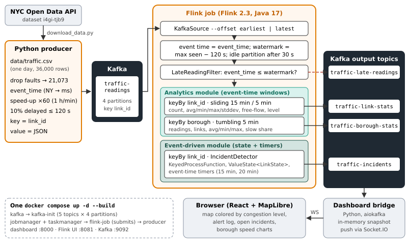
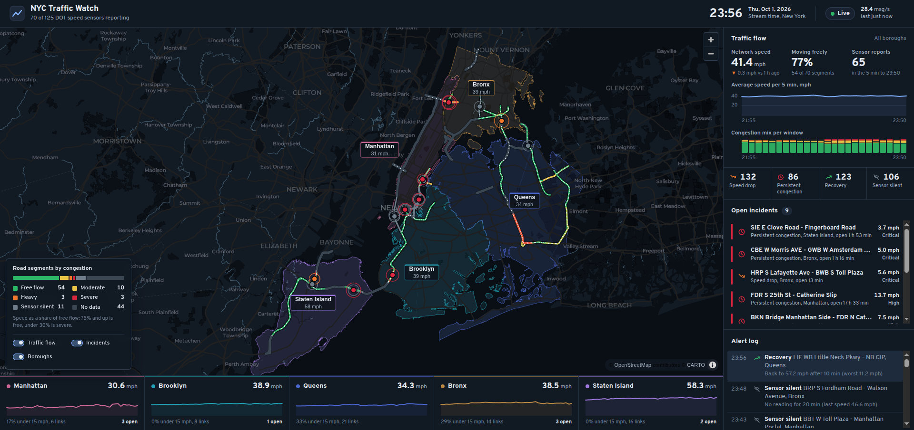

# Домашна задача 1 - Детекција на сообраќајни инциденти во Њујорк

**Изработил: Христијан Гајдов 231119**

## 1. Податочно множество и клуч за партиционирање

За изработка на првата домашна задача, јас го одбрав јавното податочно множество [NYC DOT Traffic Speeds (i4gi-tjb9)](https://data.cityofnewyork.us/Transportation/DOT-Traffic-Speeds/i4gi-tjb9). Податочното множество содржи мерења за брзината на возилата и времето на патување, бележени приближно на секои пет минути по патен сегмент. Податочното множество содржи податоци за повеќе дена и се ажурира дневно. За оваа домашна задача ги користев податоците од **1 октомври 2026 година**, кога се забележани 36.000 записи од 125 сегменти, односно околу 25 записи во минута. По отстранување на 14.927 неисправни записи, Producer-от репродуцира 21.073 мерења од 81 сегмент.

Kafka го користи `link_id` како клуч за мерењата по сегмент да останат во иста партиција. Flink го користи истиот клуч за прозорците по сегмент и за состојбата на детекторот. Агрегацијата по градска општина ги групира мерењата според `borough`.

## 2. Архитектура и Кафка topics

Flink го чита потокот од Kafka и ги проследува прифатените мерења до двата модула. Контролната табла ги чита резултатите преку сервис во Python. Compose создава четири партиции по topic. [Спецификацијата на пораките](CONTRACT.md) ги опишува полињата во JSON.



<p class="caption">Слика 1. Тек на податоците од преземањето до контролната табла. Испрекинатата стрелка го означува страничниот излез за задоцнети записи.</p>

Producer-от ги запишува исчистените мерења во `traffic-readings` topic-от како JSON. Аналитичкиот модул ги објавува резултатите од sliding windows во `traffic-link-stats`, а од tumbling windows во `traffic-borough-stats`. Детекторот ги испраќа алармите во `traffic-incidents`. Задоцнетите мерења одат во `traffic-late-readings` со полето `late_by_ms`. Клучот за статистиките по општина е `borough`, а за другите topics е `link_id`.

<div class="page-break"></div>

## 3. Producer и време на настан

Скриптата `producer/download_data.py` ги зачувува мерењата во CSV, а геометријата на патиштата ја декодира во `data/links.geojson`. Producer-от отстранува записи со невалиден формат, неисправни мерења (`status != 0` или `speed <= 0`) и дупликати според парот `(link_id, data_as_of)`. Времето `data_as_of` го толкува во зоната `America/New_York` и го запишува во `event_time` како милисекунди од Unix-епохата во UTC.

Producer-от прво ги подредува мерењата според времето на настанот. За секое мерење, неговото време е и планираното време за испраќање. Со веројатност од 10% се додава случајно доцнење до 120 секунди во времето на настаните, по што записите се испраќаат според планираниот редослед. Оригиналното време на мерење останува во пораката, а почетната вредност на генераторот овозможува повторлив распоред. Стандардното забрзување од **60×** пренесува еден час мерења за една минута реално време. Со забрзување нула, записите се испраќаат што е можно побрзо.

### Временски жигови и задоцнети записи

Flink ја зема временската ознака од `event_time`. Временскиот жиг (watermark) на секоја Kafka-партиција заостанува зад најголемото забележано време на настан за 120 секунди и една милисекунда. Таа граница го опфаќа и максималното доцнење што го додава Producer-от. Flink го зема минимумот од жиговите на активните влезови. Партиција без записи 30 секунди во реално време може да се означи како неактивна и да престане да ги задржува другите.

Жигот одредува кога се затвораат прозорците и кога се активираат тајмерите. Пред двата модула, `LateReadingFilter` ги пренасочува мерењата чие време е еднакво или помало од тековниот жиг во `traffic-late-readings`. Со `FLINK_MAX_OOO_S=30` и стандардното доцнење, жигот напредува порано и во овој topic може да завршат повеќе мерења. При двете извршувања со граница од 120 секунди немаше задоцнети мерења. Flink ја зачувува состојбата на секои 10 секунди и испорачува најмалку еднаш, па при обновување може да се појават дупликати.

## 4. Аналитика со временски прозорци

**Патен сегмент.** Се користат **sliding windows од 15 минути** со поместување на секои **пет минути**. Во тие 15 минути обично има околу три мерења, па едно невообичаено високо или ниско мерење има помало влијание врз просекот. Преклопувањето овозможува последователните резултати да користат дел од истите мерења и да се објавуваат во ритамот на сензорот. Секој резултат содржи број на мерења, просечна, минимална и максимална брзина, стандардна девијација на брзината, просечно време на патување и ниво на застој.

**Градска општина.** Се користат **tumbling windows од пет минути** за да се споредат статистиките по општина во еднакви интервали без преклопување. Секое мерење се брои само во еден интервал, па броевите на мерења од повеќе интервали може директно да се соберат. Резултатот содржи број на мерења и на различни сегменти, просечна, минимална и максимална брзина и удел на мерења под 15 милји на час.

Двете гранки ги ажурираат агрегациите со секое мерење и ги додаваат границите при затворање на прозорецот. Пресметката по сегмент чува референтна брзина за слободен сообраќај. Почетната вредност е просекот на првиот прозорец, а потоа се зема поголемата вредност од тековниот просек и 0,998 пати претходната референтна брзина. Односот на просечната и референтната брзина дава состојба на сообраќајот за патниот сегмент. Состојбата е `FREE` од 0,75 нагоре, `MODERATE` од 0,50, `HEAVY` од 0,30 и `SEVERE` под 0,30.

<div class="page-break"></div>

## 5. Детекција на инциденти управувана од настани

`IncidentDetector` е `KeyedProcessFunction` во Flink со по една `ValueState<LinkState>` за секој сегмент. Во неа се чуваат вообичаената брзина, фазата, последното мерење, најниската брзина за време на инцидентот, бројот на последователни мерења што укажуваат на нормализирање и роковите на двата тајмера. Првите три мерења ја одредуваат почетната вообичаена брзина. Потоа нормалните мерења ја ажурираат со експоненцијално пондериран подвижен просек. Таа останува фиксна за време на инцидентот и повторно се пресметува по прекин од најмалку 20 минути ако сегментот е во фаза `NORMAL`.

По почетните мерења, брзина под 50% од вообичаената предизвикува `SPEED_DROP` и го префрла сегментот од `NORMAL` во `DROPPED`. Детекторот закажува проверка 15 минути по падот. Ако сегментот тогаш сè уште е во `DROPPED` и последната брзина е под 75% од вообичаената, детекторот испраќа `PERSISTENT_CONGESTION` и го префрла во `CONGESTED`.

Две последователни мерења со најмалку 75% од вообичаената брзина предизвикуваат `RECOVERY`, го враќаат сегментот во `NORMAL` и ја откажуваат закажаната проверка ако таа сè уште чека. Посебен тајмер испраќа еден аларм `SENSOR_SILENT` по 20 минути без мерење. Секое ново мерење го презакажува тој тајмер.

Ако времето на следното мерење за сегментот го достигне рокот пред временскиот жиг, детекторот прво го обработува закажаното дејство. Алармите содржат сегмент, време на настанот, вообичаена и измерена брзина и степен на сериозност. Алармите за инциденти опишуваат обрасци во сензорските мерења.

## 6. Контролна табла во живо

Посредничкиот сервис во Python чита од Kafka, ја испраќа тековната состојба при поврзување и доставува новости преку Socket.IO. Интерфејсот во React и MapLibre прикажува застој по сегмент, историја на брзината, активни инциденти и трендови по општини. Временската лента го обновува приказот за избран момент од последните 24 часа според времето на настаните.



<p class="caption">Слика 2. Контролната табла при репродукција на мерењата од 1 октомври 2026 година.</p>

<div class="page-break"></div>

## 7. Споредба на почетните позиции earliest и latest

Кога го користиме latest flink job-от ги чита податоците како што стигнуваат во kafka и ги игнорира претходно запишаните, па така ако започнеме job со latest, а претходно сме имале податоци во kafka topic-от тогаш тие податоци што биле претходно запишани flink job ги игнорира. Од друга страна ако flink job-от го започнеме со earliest и веќе имаме податоци во Kafka topic-от од интерес, flink job-от ги зема сите податоци што се во topic-от (и тие што се веќе зачувани и тие од претходно) и ги користи во своето процесирање.

Двете извршувања користеа нови topics со по четири партиции, паралелизам два во Flink и ист редослед на **21.073 влезни мерења**. Со `--offset latest`, прво стартуваше апликацијата, по што Producer-от ги репродуцираше мерењата со забрзување од 600×. Со `--offset earliest`, Producer-от ги запиша мерењата за целиот ден со максимална брзина за 0,2 секунди, пред да стартува апликацијата.

При `latest`, со постепено испраќање на мерењата, првиот резултат пристигна **1,0 секунда** по првиот влезен запис во Kafka, а последниот по **144,0 секунди**. При `earliest`, кога се обработија веќе запишаните мерења, првиот резултат пристигна **2,9 секунди** по поднесувањето на задачата во Flink, а последниот по **4,4 секунди**. Во тоа време е вклучено и стартувањето на задачата.

Двете извршувања дадоа **21.578 статистики по сегмент, 1.435 статистики по општина и 448 аларми**, без задоцнети мерења.

Статистиките по сегмент и содржината на алармите се совпаднаа. Осум општински просеци се разликуваа за 0,01 милја на час поради различниот редослед на собирање броеви со подвижна запирка од различни партиции. Совпаѓањето произлегува од групирањето според времето на настаните, истиот редослед на мерењата по сегмент и начинот на обработка на роковите. Двете извршувања дадоа 132 аларми за пад на брзината, 86 за долготраен застој, 124 за нормализирање и 106 за прекин на мерењата.

**Крај на влезните податоци.** Последното мерење беше во **23:58:12 по време во Њу Јорк**. Kafka остана неограничен извор и апликацијата продолжи да работи. Во двата случаи жигот запре во **23:56:11.999**. Без понови временски ознаки, останаа **200 прозорци по сегмент, 5 прозорци по општина, 71 тајмер за прекин на мерењата и 2 тајмера за долготраен застој**. Петте општински прозорци го опфаќаат периодот од 23:55 до полноќ. Шест патни сегменти останаа во долготраен застој, а кај уште два инцидентот остана отворен со закажана проверка. Самото означување партиции како неактивни не го придвижува жигот. Понови временски ознаки овозможуваат да се затворат прозорците и да се активираат тајмерите.

## 8. Стартување и проверка

Командите се извршуваат од главниот фолдер на репозиториумот со `docker compose`. При првото стартување Compose ги презема податоците ако датотеките недостигаат. Контролната табла е на [localhost:8000](http://localhost:8000), а Flink е на [localhost:8081](http://localhost:8081).

```sh
docker compose up -d --build
scripts/consume.sh --counts
scripts/consume.sh traffic-incidents --max-messages 5
```

Во [README](../README.md) се дадени командите за преземање и посебно стартување на Producer-от и Flink со Kafka на `localhost:9092`. Споредбата се повторува со `scripts/offset-experiment.sh` во посебна Compose-околина. Скриптата ја ресетира околината и нејзините складишта меѓу извршувањата и ги зачувува извештајот `experiment-out/report.md` и извозот на податоците од Кафка topics.
